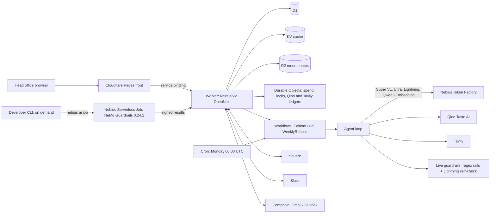

# Local Edition

**A weekly local edition for every store in a chain, built from the taste of each block (Qloo + NVIDIA Nemotron on Nebius).**

Live demo: **https://localedition.pages.dev**

## Try the sample chain in 30 seconds

1. Open https://localedition.pages.dev and press **Open the sample chain**. You land on a map of Kettle & Kiln, a *sample* coffee chain with eight stores at real New York corners.
2. Press **Build this week's editions** and watch the agent work store by store (tool calls, models, tokens and cost stream in live).
3. Open any store: the front page has four items with their evidence (open the evidence drawer). Press **Approve all**, then open the **staff card**.
4. Optional: **Connections** shows Square, Slack, Gmail/Outlook and the calendar feed; `/proof` and `/limits` show what ran, on which model, at what cost, and every budget.

## What it does

For each store, once a week, the agent builds an edition from that block's taste:

- **Special**: one new drink or bite, taken from the chain's own menu (read from a Square catalog, a photo of the menu board, or a CSV), tuned to the block.
- **Sound brief**: what to play in the room, with artists that skew local.
- **Local partner**: a neighbouring place worth a tie-in, with an offer idea.
- **Event night**: something to host that week, tied to a real local event when one is found.

Every item carries evidence (source, endpoint, numbers) and an item without evidence is dropped, never shown. A Nemotron 3 Ultra reviewer checks the whole chain for near-identical stores. Head office approves on a map of all stores; approved editions become a one-page **staff card** (phone first, public link) for each store.

## Connectors, and what is live

Each connector is built and tested against the providers' documented API shapes (196 unit tests across the Square, Slack, Gmail/Outlook and calendar code, with provider calls faked). The Composio auth configs for Gmail and Outlook exist. **No live sandbox or test account is connected yet**: there are no Square or Slack credentials on the deployed app and no Gmail consent, so on https://localedition.pages.dev none of the three has run against its real provider.

| Tool | What it does here | Tested against | Live on localedition.pages.dev today |
|---|---|---|---|
| Square | Two ways: imports the menu (locations become stores); approving a special publishes it back; signed webhooks update the app; sales per special are read back. OAuth or a token. | Square's documented API shapes; sandbox connection pending. | No |
| Slack | Head-office digest with **Approve** and **Regenerate** buttons (signed interactions), staff cards to a store channel. | Slack's documented payloads and signing; test-workspace connection pending. | No |
| Gmail / Outlook (via Composio) | The staff card is emailed to the store; replies from managers are classified (sold out, sold well, change request, problem, other) and become suggestions for next week's build. Needs a consented mailbox. | Composio's documented API shapes; auth configs exist, no mailbox consented yet. | No |
| Calendar feed | A private `.ics` link per store with its event night. Needs no external account. | Unit tests on the feed. | Yes |

## Built on

| Technology | What it is | What it does here |
|---|---|---|
| **Qloo Taste AI** | A cross-domain taste and affinity API. | The block profile: what the people near each store lean toward, and how that differs from the city. Endpoints used (host `hackathon.api.qloo.com`): `GET /search` (find brands the chain resembles), `GET /v2/insights` (block tags, nearby artists, brands and places, heatmap, rising taste), `GET /v2/trending` (what is rising), `GET /v2/analysis/compare` (two stores side by side). No customer or personal data is ever sent: only coordinates, entity ids and tag urns. |
| **NVIDIA Nemotron 3.5 Super VL** (`nvidia/Nemotron-3.5-Super-VL`) | A vision-language model with tool calling. | The agent loop that plans each edition and calls tools, and the menu-board photo reader. |
| **NVIDIA Nemotron 3 Ultra** (`nvidia/Nemotron-3-Ultra-550b-a55b`) | A large reasoning model. | The reviewer: judges every store's edition against the others and asks for a regenerate with a hint. |
| **NVIDIA Nemotron 3.5 Lightning** (`nvidia/Nemotron-3_5-Lightning`) | A fast, cheap model. | Copy for items and staff cards, Tavily event triage, the live self-check, and classifying email replies. |
| **Qwen3 Embedding 8B** (`Qwen/Qwen3-Embedding-8B`) | A text embedding model. | Matches menu items and nearby places to each block's taste, and finds near-identical items across stores (cosine clash). |
| **Nebius Token Factory** | OpenAI-compatible inference for open models. | Serves every model above. |
| **NeMo Guardrails 0.24.1** | NVIDIA's guardrails library. | Certifies every item (a custom health-claim rail, prompt-injection stripping, and NeMo's `self check output` rail on Lightning) and runs a red-team eval. It runs in a **Nebius Serverless Job** (`jobs/`, `guardrails/`) that is **started from the CLI on demand**, with `npx tsx scripts/nebius-job.ts certify eval`. It is **not on a schedule**: Cloudflare Workers cannot reach Nebius's control plane (it answers Cloudflare egress with a 522, see `docs/NEBIUS-REST.md`). Results are posted back signed and show on `/proof` as `manual` runs. The **live path** in the Worker (every head-office edit and every build) uses a TypeScript mirror of the regex rails plus the Lightning self-check, and marks items `checkedBy: live`. |
| **Tavily** | A search API for agents. | Search and extract for this week's local events near each store; crawl of the chain's own site to draft the brand voice. |
| **Cloudflare** | Workers, Pages, D1, KV, R2, Durable Objects, Workflows, cron. | Worker via OpenNext fronted by Pages; D1 for data; KV for provider caches; R2 for menu photos; Durable Objects for the spend meter, build lock and call ledgers; Workflows for builds (one retried step per store); cron every Monday 00:00 UTC for the weekly rebuild, which runs on **Token Factory and Tavily only**. |

## Architecture



## Limits and budgets

- **Spend cap**: `SPEND_CAP_USD` (default $5) on Token Factory, enforced in one Durable Object with reserve-then-settle. Each visitor workspace gets a $0.40 sub-budget and each network a $0.80 daily cap; $1.50 is reserved for the demo workspace and the weekly job.
- **Qloo call ledger**: at most 300 live calls in total and 40 a day across all visitors, reserved before each call and never refunded, plus a 14-day response cache. Regenerate never reaches Qloo.
- **Tavily ledger**: one global ledger of 80 credits in total and 10 a day, results cached 7 days; live search is limited to the demo workspace's unmodified sample stores and chain setup.
- **Rate limits** per workspace and per IP on builds, regenerate, staff cards, edits, menu reads, brand search and brand-voice drafting (the table is on `/limits`; the code is `src/server/limits-table.ts`).
- At most 60 new workspaces an hour; workspace data expires.

## Honest limitations

- Kettle & Kiln is **sample data**, labelled so in the app. It is not a customer.
- Square, Slack and Gmail/Outlook are **not connected** on the live app yet (see the connectors table); only the calendar feed runs without an account.
- **Qloo**: the code, ledger and tests are in place and used under the hackathon's terms, but as committed `QLOO_MODE` is `replay`, which serves synthetic Qloo-shaped fixtures (`fixtures/qloo/`, invented numbers, badged "Sample data" and counted as a coverage gap on `/limits`) until a Qloo key is set on the Worker. Real Qloo responses are never committed; recordings go to the gitignored `.recordings/`.
- NeMo Guardrails runs only when someone starts the job from the CLI; the weekly cron does not call Nebius.
- The first live Tavily prefetch of a week can take longer than the agent's 25 s tool timeout; the work finishes and is cached.
- `docs/` holds working notes and smoke-test records from the build; `docs/CONTRACT.md`, `docs/CLOUDFLARE.md` and `docs/DEPLOY.md` are the reference ones.

## Run locally

```sh
npm install
NEXT_PUBLIC_DATA_MODE=mock npm run dev   # UI on typed mock data, no server calls
npm run dev                              # DATA_MODE=app: real routes; providers default to replay/fixture without keys
```

Open http://localhost:3000. Add `NEBIUS_API_KEY`, `TAVILY_API_KEY` and `QLOO_API_KEY` to `.env.local` and set `TF_MODE`, `TAVILY_MODE`, `QLOO_MODE` to `live` to use real providers; `.env*` is gitignored. `scripts/deploy.sh` and `scripts/deploy-secrets.sh` deploy to your own Cloudflare account and read credentials through a local `~/.secret-store/inject.sh` helper, so adapt them to your own secret handling.

## Tests

```sh
npm run typecheck && npm run lint
npx vitest run                  # 115 files, 1360 tests
npm run e2e                     # Playwright (starts next dev)
cd guardrails && python3 -m pytest -q   # NeMo rails: 115 passed, 1 skipped
python3 -m pytest -q tests/e            # job scripts: 12 passed
```

## License

MIT, see `LICENSE`. Copyright 2026 JoelOnBeat.
